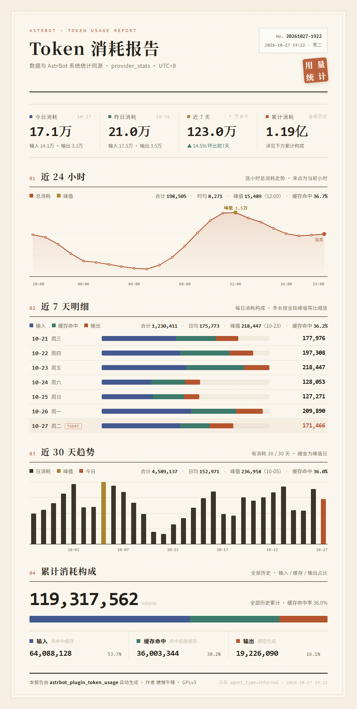
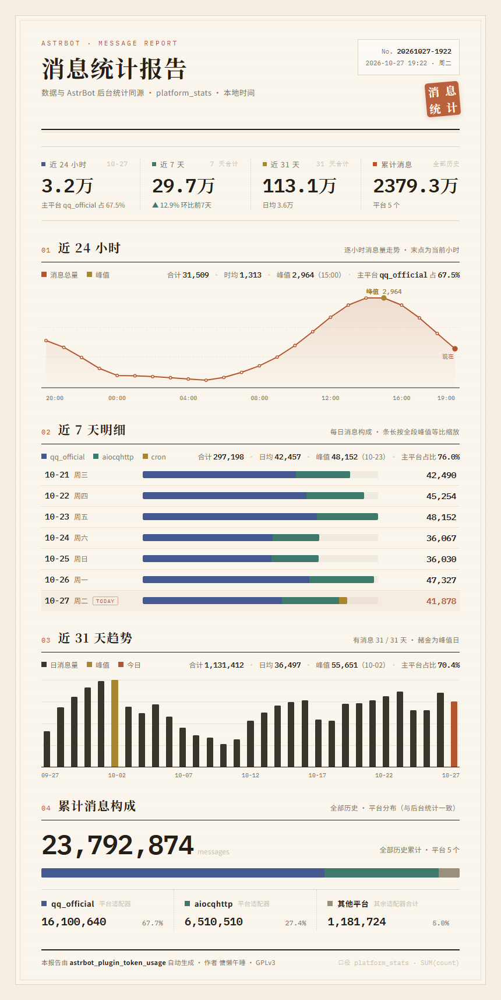

# astrbot_plugin_token_usage

> 精美 Token 消耗与消息量统计插件 —— 近 24 小时 / 近 7 天 / 近 30·31 天 / 累计，一张图看全。
> 数据直接读取 AstrBot 系统库，与 dashboard 统计同源同口径。

- **作者**：慵懒午睡
- **协议**：[GPLv3](LICENSE)
- **适用**：AstrBot v4.0+

## ✨ 功能特性

| 功能 | 说明 |
| --- | --- |
| Token 统计 | 近 24 小时折线图、近 7 天账簿条、近 30 天趋势、累计构成，一张报表看全 |
| 消息统计 | 近 24 小时折线图、近 7 天明细、近 31 天趋势、累计构成（平台分布，与后台统计一致） |
| 总统计 | 一条指令同时生成并发送 Token 与消息两张报表图片 |
| 近 24 小时 | 逐小时折线图（含面积渐变），峰值与当前小时标注，附合计、时均、峰值等指标 |
| 近 7 天 | 每日横向账簿条（Token：输入 / 缓存 / 输出；消息：用户 / 机器人） |
| 近 30 / 31 天 | 每日趋势柱状图，峰值高亮，附区间合计与日均 |
| 累计统计 | 全历史累计数字 + 构成比例条 + 分项明细 |
| 精美渲染 | 暖纸账簿风 HTML 报表（宋体标题 + 等宽数字 + 三色账簿条），通过 AstrBot 内置 t2i 渲染服务出图 |
| 定时推送 | 每天指定时间自动把 Token 报表图片推送到一个或多个群聊 |
| 文本降级 | 渲染服务不可用或数据库缺失时自动降级为纯文本报表 |
| 安全只读 | 以 SQLite 只读模式打开系统库，不影响 AstrBot 正常运行 |





## 📦 安装

1. 将本目录放入 AstrBot 的 `data/plugins/` 下（最终路径形如 `data/plugins/astrbot_plugin_token_usage/`）；
2. 在 WebUI「插件管理」中重载插件；
3. 在插件配置中按需填写推送群号与定时时间。

无需安装任何额外 Python 依赖。

## 🎛️ 配置项

| 配置键 | 类型 | 默认值 | 说明 |
| --- | --- | --- | --- |
| `db_path` | string | 空 | 留空自动推断 AstrBot 的 `data_v4.db`；非标准部署时填绝对路径 |
| `admin_only` | bool | `true` | 是否仅管理员可用统计指令 |
| `schedule_enabled` | bool | `false` | 是否启用每日定时推送 |
| `schedule_time` | string | `08:00` | 推送时间（24 小时制，上海时区） |
| `schedule_groups` | string | 空 | 推送目标群号，多个用逗号分隔，例如 `123456789,987654321` |
| `schedule_platform_id` | string | 空 | 推送使用的平台适配器 ID，留空自动取第一个可用平台 |

## 💬 指令

| 指令 | 说明 |
| --- | --- |
| `/token` | 生成 Token 用量报表图片（近 24 小时 / 近 7 天 / 近 30 天 / 累计） |
| `/token统计` | 同上（中文别名） |
| `/看看token` | 同上（兼容参考插件的使用习惯） |
| `/消息统计` | 生成消息统计报表图片（近 24 小时 / 近 7 天 / 近 31 天 / 累计） |
| `/看看消息` | 同上（别名） |
| `/总统计` | 同时生成并发送 Token 与消息两张报表图片（并行渲染） |
| `/全部统计` | 同上（别名） |

> 默认仅管理员可用，可在配置中关闭 `admin_only`。

## 🖼️ 关于 t2i 渲染

插件通过 `Star.html_render()` 调用 AstrBot 内置的文转图管线：

1. 优先使用 AstrBot WebUI 中配置的**远程/自建 t2i 渲染服务**（例如自建于局域网 `http://192.168.31.54:8999`，在 AstrBot 配置「文转图」处填写端点即可，插件无需再配置）；
2. 渲染服务返回图片后直接发送，**模板在服务端由 Jinja2 渲染**，插件侧不执行任何外部脚本；
3. 若渲染服务不可用或返回异常，自动降级为纯文本报表。

模板会自动声明 `<meta name="viewport" content="width=860">`，t2i 服务据此输出 860px 宽的完整长图。

## 📐 统计口径

### Token 统计

- 数据来源：AstrBot 主数据库 `data_v4.db` 的 `provider_stats` 表，**只读连接**；
- 过滤条件：`agent_type = 'internal'`，与 dashboard 系统统计一致；
- 三项指标：`token_input_other`（输入）、`token_input_cached`（缓存命中）、`token_output`（输出），合计 = 三者之和；
- 日期切分：数据库 `created_at` 为 UTC 时间，插件按**上海时区（UTC+8）**自然日换算查询边界；
- 「近 24 小时」按整点小时分桶（含当前小时，共 24 桶），「今日/昨日」为自然日数据；
- 「累计」为全历史数据。

### 消息统计

- 数据来源：AstrBot 主数据库 `data_v4.db` 的 `platform_stats` 表，**只读连接**；
- 口径与 AstrBot 后台（dashboard）完全一致：后台的累计消息数即 `SUM(count)`，本插件直接采用同一张表、同一口径；
- `platform_stats` 由 AstrBot 每收到一条消息时按「小时 × 平台」累加（`count`），本插件按时间窗口聚合；
- `timestamp` 为服务器本地时间的整点桶，历史版本写入的 Unix 时间戳与无效记录会被自动兼容 / 跳过；
- 累计构成按 `platform_id`（平台适配器）分布展示；
- 「近 24 小时」为 24 个整点小时窗口，「近 7 / 31 天」为自然日窗口（含今天）。

> Token 读取逻辑参考 [yuebai5203/astrbot_plugin_msg_stat](https://github.com/yuebai5203/astrbot_plugin_msg_stat) 的实现（GPLv3）。

## 🕗 定时推送说明

- 后台守护任务每 20 秒检查一次当前时间，到点后在**当天仅发送一次**（跨天自动重置）；
- 报表图片只渲染一次，随后依次发送到所有配置的群聊；
- 推送失败（例如平台未连接）会记录日志，次日重新推送；
- 「上次推送日期」持久化在插件目录的 `state.json`，重载插件不会重复发送。

## ❓ 常见问题

**Q：提示「未找到 AstrBot 数据库 data_v4.db」？**
A：确认 AstrBot 使用 v4 数据目录结构；若为自定义部署，把 `data_v4.db` 的绝对路径填入 `db_path`。

**Q：发出的是文字不是图片？**
A：说明 t2i 渲染服务不可用。请检查 AstrBot「文转图」配置中的渲染端点是否可访问（例如自建服务 `http://192.168.31.54:8999`），日志中会有具体报错。

**Q：数据与 dashboard 不一致？**
A：请确认 AstrBot 版本一致；本插件与 dashboard 使用同一张表、同一过滤条件与同一时区口径。

## 📁 文件结构

```
astrbot_plugin_token_usage/
├── main.py              # 插件入口：指令、定时推送
├── token_query.py       # provider_stats 只读查询（与 dashboard 同源）
├── message_query.py     # platform_stats 只读查询（与后台消息统计同口径）
├── page_builder.py      # 页面数据聚合与格式化
├── templates/
│   ├── stats.html       # Token 统计页模板（t2i 服务端渲染）
│   └── messages.html    # 消息统计页模板（t2i 服务端渲染）
├── _conf_schema.json    # 插件配置 schema
├── metadata.yaml        # 插件元数据
├── preview.py           # 本地设计预览脚本（开发用）
├── preview.png          # Token 报表效果图
├── preview_msg.png      # 消息报表效果图
├── requirements.txt
├── LICENSE              # GPLv3
└── README.md
```

## 📄 License

本项目基于 [GNU General Public License v3.0](LICENSE) 开源。

统计读取逻辑参考 `astrbot_plugin_msg_stat`（作者 yuebai，GPLv3），特此致谢。
